  

  
  
  
  
  

  <a href="#-about">About</a> &nbsp;|&nbsp;
  <a href="#-order-board">Order board</a> &nbsp;|&nbsp;
  <a href="#-menu">Menu</a> &nbsp;|&nbsp;
  <a href="#-the-pass">The pass</a> &nbsp;|&nbsp;
  <a href="#-stats">Stats</a> &nbsp;|&nbsp;
  <a href="#-order-up">Contact</a>

---

## 👨‍🍳 About

<table>
<tr>
<td width="60%" valign="top">

- 🎓 B.Tech CSE student at **Jain University, Bangalore**, class of 2027
- 🧭 **Resource Lead at Enigma Club**, leading a technical team
- 🔭 Building **web apps, mobile apps and order systems** for small businesses
- 🌱 Learning **advanced framework architectures and scalable backends**
- 👯 Open to **collaborating on open-source projects**
- 💬 Ask me about **React, Next.js, React Native, Node.js, FastAPI and Python**

<b>What's on the stove right now</b>

 

- [ ] **MindsTV**: iOS app, App Store submission and in-app subscriptions
- [ ] **Order management API**: restaurant orders, linking to the Petpooja POS
- [x] **Stuti Traders** and **Ganapati Build Mart**: live catalogue sites

</td>
<td width="40%" align="center" valign="middle">
  
</td>
</tr>
</table>

## 🎫 Order board

The board is live: the dashed ticket is the next open slot, and it's yours.

  

<b>Read the tickets</b>

 

| Ticket | What it is | Links |
| :-- | :-- | :-- |
| **#01 Stuti Traders** | Product catalogue with image uploads, Next.js and FastAPI | [Code](https://github.com/Burrito3000/stuti-traders) |
| **#02 Ganapati Build Mart** | Site for a hardware, plywood and furnishing supplier | [gbmart.in](https://gbmart.in), [Code](https://github.com/Archi-jain19/Ganapati-Build-Mart-Website) |
| **#03 MindsTV** | iOS app with App Store release and subscriptions | in progress |
| **#04 Order management API** | Restaurant order API, linking to the Petpooja POS | in progress |
| Blind Date Enigma | Theatrical matchmaking show for a live event, React and Framer Motion | [Code](https://github.com/AaKaShAgArWaLs/Blind_Date_Enigma) |
| Inceptrix 2.0 | Hackathon platform | delivered |

<b>📌 Pinned repositories</b>

 

<b>🧪 Earlier experiments</b>

 

| Project | What it is |
| :-- | :-- |
| 🔒 [Password Encrypter](https://github.com/AaKaShAgArWaLs/Password-Encrypter) | Data encryption and decryption using matrix operations |
| 🎲 [Dice Rolling Game](https://github.com/AaKaShAgArWaLs/Dice-Rolling-Game) | Interactive dice simulator with randomization |
| 📊 [Power BI Sales Dashboard](https://github.com/AaKaShAgArWaLs/PowerBi) | Sales performance dashboard with interactive metrics |

## 🍽️ Menu

What I cook for clients. Tap a dish to see what's in it.

<b>🌐 Website development</b>

 

Custom business sites and product catalogues, built in React or Next.js, tailored to how the business actually works.

<b>📱 Mobile apps</b>

 

React Native apps for iOS and Android, including store submission and in-app subscriptions.

<b>⚙️ Backend and APIs</b>

 

REST APIs in FastAPI, Flask or Node.js, with MongoDB or MySQL behind them.

<b>🧾 Order systems and POS links</b>

 

Order management for restaurants and shops, including connecting to point-of-sale software like Petpooja.

<b>📐 Responsive design</b>

 

Layouts that work on phones first, then scale up.

<b>⚡ Speed and SEO</b>

 

Fast-loading pages that search engines can read.

## 🛎️ The pass

Everything that goes through the kitchen.

  

<table>
<tr><td><b>Frontend</b></td><td></td></tr>
<tr><td><b>Backend</b></td><td></td></tr>
<tr><td><b>Data</b></td><td></td></tr>
<tr><td><b>Languages</b></td><td></td></tr>
<tr><td><b>Tools</b></td><td></td></tr>
</table>

## 📊 Stats

  

  
  

  

  

## 🛎️ Order up

  

  
  
  

