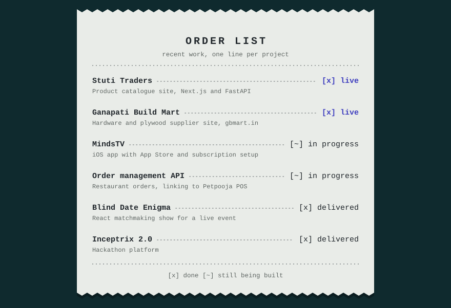
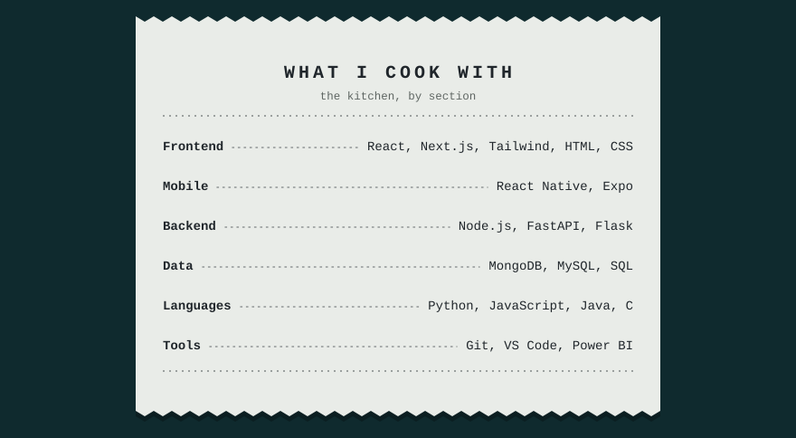

  

  

  <a href="https://github.com/Burrito3000/stuti-traders">Stuti Traders code</a> |
  <a href="https://gbmart.in">gbmart.in</a> |
  <a href="https://github.com/Archi-jain19/Ganapati-Build-Mart-Website">Ganapati Build Mart code</a> |
  <a href="https://github.com/AaKaShAgArWaLs/Blind_Date_Enigma">Blind Date Enigma code</a>

  

  

  <a href="mailto:aakashrkl603@gmail.com">Email</a> |
  <a href="https://www.linkedin.com/in/aakashagarwal1609/">LinkedIn</a> |
  <a href="https://twitter.com/AaKaShAgArWaLs">Twitter</a>

