  

  
  
  
  
  

  <a href="#-about">About</a> &nbsp;|&nbsp;
  <a href="#-order-board">Order board</a> &nbsp;|&nbsp;
  <a href="#-menu">Menu</a> &nbsp;|&nbsp;
  <a href="#-the-pass">The pass</a> &nbsp;|&nbsp;
  <a href="#-stats">Stats</a> &nbsp;|&nbsp;
  <a href="#-order-up">Contact</a>

---

## 👨‍🍳 About

<table>
<tr>
<td width="60%" valign="top">

- 🎓 B.Tech CSE student at **Jain University, Bangalore**, class of 2027
- 🧭 **Resource Lead at Enigma Club**, leading a technical team
- 🔭 Building **web apps, mobile apps and order systems** for small businesses
- 🌱 Learning **advanced framework architectures and scalable backends**
- 👯 Open to **collaborating on open-source projects**
- 💬 Ask me about **React, Next.js, React Native, Node.js, FastAPI and Python**

<b>What's on the stove right now</b>

 

- [ ] **MindsTV**: iOS app, App Store submission and in-app subscriptions
- [ ] **Order management API**: restaurant orders, linking to the Petpooja POS
- [x] **Stuti Traders** and **Ganapati Build Mart**: live catalogue sites

</td>
<td width="40%" align="center" valign="middle">
  
</td>
</tr>
</table>

## 🎫 Order board

The board is live: the dashed ticket is the next open slot, and it's yours.

  

<b>🎟️ Read the tickets</b>

 

Tap a ticket to see what it is, what it's built with and where to find it.

 &nbsp;<b>#01 Stuti Traders</b>

 

A product catalogue with image uploads. The Next.js frontend runs on Vercel and talks to a FastAPI backend on a VPS.

    

[View the code](https://github.com/Burrito3000/stuti-traders)

 &nbsp;<b>#02 Ganapati Build Mart</b>

 

The website for a hardware, plywood and furnishing supplier: product showcase, mobile-friendly pages and contact links.

 

[Visit gbmart.in](https://gbmart.in) &nbsp;|&nbsp; [View the code](https://github.com/Archi-jain19/Ganapati-Build-Mart-Website)

 &nbsp;<b>#03 MindsTV</b>

 

An iOS app, now working through App Store submission and in-app subscription setup, with a MySQL database on AWS RDS.

  

Private project.

 &nbsp;<b>#04 Order management API</b>

 

A custom order API for restaurants, being connected to the Petpooja point-of-sale system so orders flow straight to the kitchen.

 

Private project.

 &nbsp;<b>Blind Date Enigma</b>

 

A theatrical matchmaking show built for a live event, with staged reveals and animated transitions.

    

[View the code](https://github.com/AaKaShAgArWaLs/Blind_Date_Enigma)

 &nbsp;<b>Inceptrix 2.0</b>

 

A hackathon platform, second edition.

Private project.

<b>📌 Pinned repositories</b>

 

<table>
<tr>
<td width="50%" valign="top"></td>
<td width="50%" valign="top"></td>
</tr>
<tr>
<td width="50%" valign="top"></td>
<td width="50%" valign="top"></td>
</tr>
<tr>
<td width="50%" valign="top"></td>
<td width="50%" valign="top"></td>
</tr>
</table>

<b>🧪 Earlier experiments</b>

 

<table>
<tr><th align="left">Project</th><th align="left">Language and activity</th></tr>
<tr><td valign="top"><b>🔒 <a href="https://github.com/AaKaShAgArWaLs/Password-Encrypter">Password Encrypter</a></b> Encrypts and decrypts data using matrix operations</td><td valign="top">  </td></tr>
<tr><td valign="top"><b>🎲 <a href="https://github.com/AaKaShAgArWaLs/Dice-Rolling-Game">Dice Rolling Game</a></b> Interactive dice simulator with randomization</td><td valign="top">  </td></tr>
<tr><td valign="top"><b>📊 <a href="https://github.com/AaKaShAgArWaLs/PowerBi">Power BI Sales Dashboard</a></b> Sales performance dashboard with interactive metrics</td><td valign="top">  </td></tr>
</table>

Also in the archive: <a href="https://github.com/AaKaShAgArWaLs/JUHackathon">JUHackathon</a> and <a href="https://github.com/AaKaShAgArWaLs/Hackathon_23BTRCT001">Hackathon_23BTRCT001</a>.

## 🍽️ Menu

What I cook for clients. Each dish lists what's included and a real example.

<table>
<tr>
<td width="50%" valign="top">

### 🌐 Website development
Custom business sites and product catalogues.

  

What's included

 

- Pages built around your products or services
- Contact and enquiry links that work on a phone
- Image uploads for catalogues
- Deployed and live on a real domain

Example: [Ganapati Build Mart](https://gbmart.in)

</td>
<td width="50%" valign="top">

### 📱 Mobile apps
iOS and Android apps, shipped to the stores.

 

What's included

 

- React Native builds for both platforms
- App Store and Play Store submission
- In-app subscription setup

Example: MindsTV, an iOS app

</td>
</tr>
<tr>
<td width="50%" valign="top">

### ⚙️ Backend and APIs
The part customers never see but always depend on.

   

What's included

 

- REST APIs with clear endpoints
- Database design in MongoDB or MySQL
- Hosting on a VPS or cloud database

Example: [Stuti Traders](https://github.com/Burrito3000/stuti-traders) catalogue API

</td>
<td width="50%" valign="top">

### 🧾 Order systems and POS links
Orders that reach the kitchen or counter on their own.

 

What's included

 

- Order management for restaurants and shops
- Connecting to point-of-sale software like Petpooja
- Orders flowing from the app to the till

Example: a restaurant order API, in progress

</td>
</tr>
<tr>
<td width="50%" valign="top">

### 📐 Responsive design
Phone first, then bigger screens.

 

What's included

 

- Layouts tested on small screens first
- Readable text and tappable buttons
- One design that scales up to desktop

Example: [Ganapati Build Mart](https://gbmart.in), built mobile-friendly

</td>
<td width="50%" valign="top">

### ⚡ Speed and SEO
Fast pages that search engines can read.

What's included

 

- Lightweight pages that load quickly
- Search-friendly markup and titles
- Static hosting on Vercel where it fits

Example: [Stuti Traders](https://github.com/Burrito3000/stuti-traders) frontend on Vercel

</td>
</tr>
</table>

## 🛎️ The pass

Everything that goes through the kitchen.

  

<table>
<tr><td><b>Frontend</b></td><td></td></tr>
<tr><td><b>Backend</b></td><td></td></tr>
<tr><td><b>Data</b></td><td></td></tr>
<tr><td><b>Languages</b></td><td></td></tr>
<tr><td><b>Tools</b></td><td></td></tr>
</table>

## 📊 Stats

  

  
  

  

  

## 🛎️ Order up

  

  
  
  

